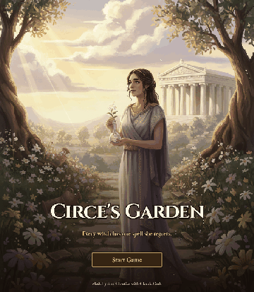
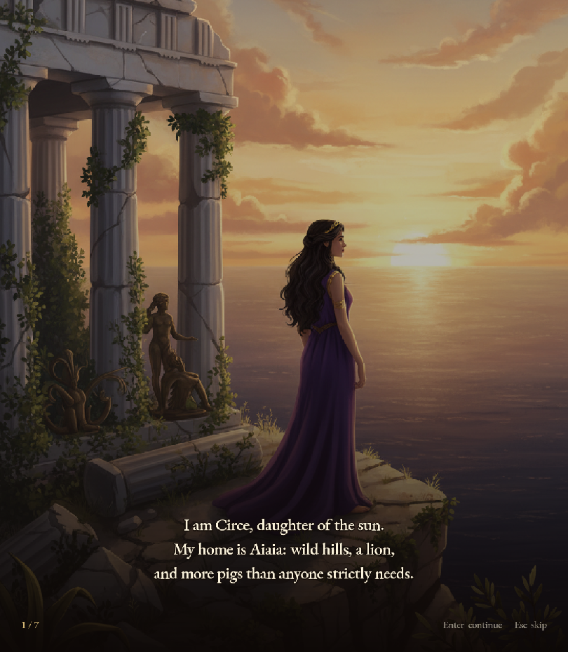
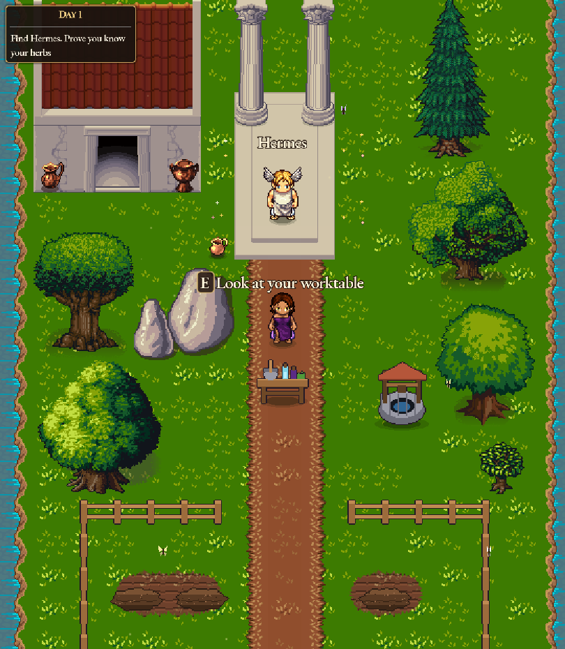
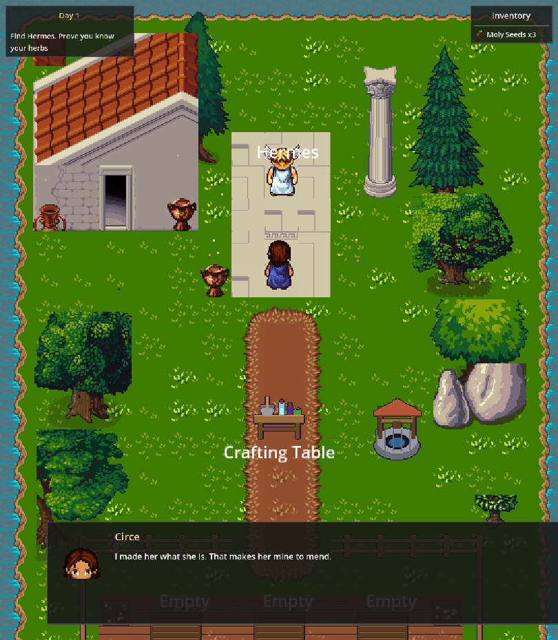

# Circe's Garden

A short story game you can play in your browser, about the witch Circe from Greek myth, inspired by Madeline Miller's novel *Circe*.

I made this game as a gift for a friend, and as a way to build something moderately complex with AI while learning Git, GitHub and vibe coding.
It taught me a lot. Vibe coding a simple web game with no rules to follow is easy. A game that has to follow a specific story and run on a Game Boy Color-style handheld console is a very different job.

Built by Sam Cloutier with Claude Code, an AI coding tool.

### ▶ [Play it in your browser](https://opensourcesam.github.io/circes-garden/)

Play on a laptop or desktop with a keyboard (Chrome, Edge or Firefox). On a phone? Watch the preview below and save the link for later.



## Try it in five minutes

1. Open **[the browser version](https://opensourcesam.github.io/circes-garden/)**. The first visit downloads about 60 MB, which takes 10 to 30 seconds.
2. Click **Start Game**.
3. The prologue is a short series of paintings with narration. Press **Enter** to turn each one, or **Esc** to skip it.
4. On the island, hold the **arrow keys** (or **W A S D**) to walk. The box in the top-left corner always shows what to do next.
5. Hermes is just above you, on the stone terrace at the top of the screen. Walk up to him and press **E** to talk. Press **Enter** to move the conversation along.
6. He gives you a herb lesson: **left** and **right** pick a herb, **E** confirms. Three right answers win.

Those five minutes show the core of the game: the story, the characters and the herb lesson.
The whole game takes about 20 minutes, through farming, brewing a potion, sailing to the monster Scylla, and the ending.

## The story

Circe, exiled to the island of Aiaia, tries to undo the worst thing she ever did: turning the nymph Scylla into a monster.
Hermes drops by, teases her, and teaches her about a magic herb called moly. She grows it, brews a Calming Draught, and sails to Scylla.
The draught calms Scylla for one breath. Then she is the monster again. Circe sails home and tends her garden.
That is the ending in the book, and it is the ending here.

| The prologue | The island | Meeting Hermes |
|---|---|---|
|  |  |  |

## How it was made, in plain words

- **One person, with AI doing the typing.** I directed the game and wrote the rules the AI worked from; Claude Code wrote the code.
- **The art is free art shared by artists online, put together by code.** Every artist is credited in [docs/CREDITS.md](docs/CREDITS.md).
- **The first attempt failed, and that is documented.** AI-generated character art did not hold together, so it was replaced. [How it was made](docs/MAKING-OF.md) tells that story.
- **A script plays the whole game automatically.** It opens the game in a browser, plays the story from start to finish, and takes a screenshot at each step. The screenshots on this page come from it.

## Known limits

- Keyboard or controller only: no touch controls yet, and no saving.
- The music and sound effects are placeholders.

---

## For developers

Built in Godot 4.5.1 with GDScript and no add-ons. To run from source, open `project.godot` in Godot 4.5.1 and press Play.
To run the browser build locally, serve `docs/` with a web server (for example `python -m http.server` inside `docs/`); opening the file directly does not work.

- **Structure:** three autoloads (game state, scene manager, audio), one world scene with two zones, and entities as small scripts. Written with Claude Code against a spec-first [`CLAUDE.md`](CLAUDE.md).
- **Story as data:** every line of dialogue, the prologue, the quest titles and the credits live in `game/data/story_text.gd`; the entity scripts only look lines up by id.
- **Art pipeline:** Circe, Hermes and the pigs are composed from LPC layers with the Universal LPC Spritesheet Character Generator's palette files (`tools/pixelart/lpc_compose.py`). The island and the cove use the LPC terrain, tree, rock and Ancient Greek architecture packs, cut into atlases with an autotiler for the LPC edge sets (`tools/pixelart/lpc_tiles.py`, `worldmap.py`). Scylla, who has no open asset, is drawn by code.
- **Maps as text:** the island and the cove are text maps in `tools/pixelart/worldmap.py`, resolved into tile layers, props and collision in `game/data/world_map.gd`.
- **Closed-loop playtesting:** `tools/pixelart/playtest.py` serves the web build, drives it in headless Chromium, and waits on the lines the game prints (`[Dialogue] start hermes_intro`, `[GameState] Planted moly`, player positions) before every step.

| Path | What it is |
|---|---|
| `game/` | The Godot project: `autoload/`, `scenes/` (menu, prologue, world, herb lesson, credits), `entities/` (player, Hermes, Scylla, pigs, interactables), `ui/`, `data/` (story text and the generated world map) |
| `tests/` | Headless unit and checkpoint tests; `run_all.gd` runs them |
| `tools/pixelart/` | The art pipeline, sheet checks, the browser playtest driver, GIF assembly, credits generation |
| `tools/build_web.sh` | Import, test, export and playtest in one command |
| `assets/` | Sprites, tilesets, prologue paintings, audio, and the archived February 2026 image-model pipeline |
| `docs/` | The GitHub Pages build, screenshots, credits, scorecard and making-of |
| `export_presets.cfg` | Web (threads off, so GitHub Pages can serve it), Windows and Android (arm64, debug-signed) presets |

```
python tools/pixelart/check_sheets.py        # every sprite sheet: size, alpha, frames inside cells, baseline
tools/build_web.sh                           # import, 9 headless tests, Web export, browser screenshots
tools/build_web.sh --script full             # the whole quest chain, about 7 minutes
```

Set `GODOT_BIN` to your Godot 4.5.1 binary if it is not on your PATH.
Platform notes are in [PLATFORMS.md](PLATFORMS.md).

### Downloads and self-assessment

- **Windows and Android builds** are on the [latest release](https://github.com/OpenSourceSam/circes-garden/releases/latest). The Windows build is not code-signed, and the Android build (arm64, debug-signed, for sideloading) has not yet been tried on a real device.
- A self-assessed craft [scorecard](docs/SCORECARD.md) with evidence pointers.

## Credits and licence

Story and characters after Madeline Miller's *Circe* (2018). This is a fan project and is not affiliated with the author or publisher.
Pixel art by the Liberated Pixel Cup community, credited in [docs/CREDITS.md](docs/CREDITS.md). Code under the MIT licence; see [LICENSE](LICENSE) for what it does and does not cover.
